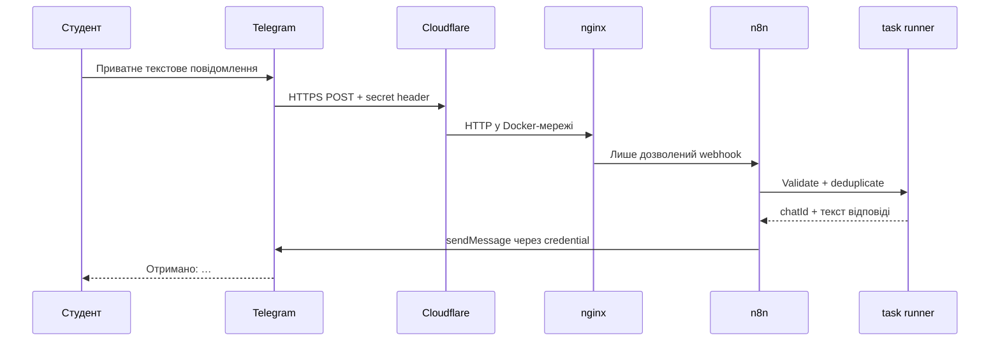

# Архітектурні рішення n8n Course Kit

Версія 0.2 · 8 листопада 2026 року.

## Контекст і мета

Пакет призначений для початківця на Windows 11. Він запускає локальний n8n,
приймає Telegram webhook через тимчасову HTTPS-адресу й відповідає з workflow.
Цільовий ноутбук — HP Pavilion 14-ce0064ur, amd64, приблизно 8 ГБ RAM. Docker
Desktop із WSL 2 та Linux-контейнер уже перевірені користувачем.

MVP навчає доставці подій і роботі workflow. AI-модель, VPS, постійний домен,
PostgreSQL і паралельні workers залишені для наступних етапів.

## Потік даних

## Прийняті рішення

1. **Docker Compose замість нативного n8n.** Він дає відтворювані версії,
   ізольовану мережу й однаковий запуск. На цільовій Windows Docker уже працює.
2. **Cloudflare Quick Tunnel для MVP.** Він має офіційний відкритий клієнт,
   Docker image і не потребує домену. Випадкову адресу launcher реєструє заново.
3. **nginx перед n8n.** Tunnel не має прямого доступу до редактора. nginx
   пропускає один точний POST-шлях із правильним Telegram secret header.
4. **Webhook node замість Telegram Trigger.** Launcher сам керує реєстрацією
   webhook, перевіряє його належність і не потребує окремого bot-сервера.
5. **Зовнішній офіційний task runner.** Code node не виконується всередині
   основного процесу n8n; n8n 3.x рекомендує external mode.
6. **SQLite для одного студента.** Постійний Docker volume достатній для
   локального MVP. Історія виконань обмежена 100 записами та сімома днями.
7. **Офіційний CLI n8n для bootstrap.** Credential імпортується, workflow
   створюється лише за відсутності, потім публікується. Наявний workflow не
   перезаписується, тому зміни студента зберігаються.
8. **PowerShell 5.1 + WinForms.** Windows має ці компоненти без окремого runtime.
   Довгі дії виконуються у background job, а подвійний запуск блокується.

Версії та результати дослідження записані в [RESEARCH.md](RESEARCH.md).

## Межі довіри та секрети

- Інтернет завершується на Quick Tunnel; nginx є обов'язковою межею перед n8n.
- Редактор доступний лише через `127.0.0.1`; Docker-сервіси proxy і task broker
  не публікують порти у Windows.
- Telegram token, n8n encryption key, webhook secret і runner token зберігаються
  через DPAPI CurrentUser поза репозиторієм.
- Під час роботи ключі монтуються як локальні файли з ACL. Telegram token існує
  у відкритому вигляді лише у короткочасному credential JSON під час імпорту.
- Workflow містить посилання на credential ID, а не токен.
- Пакет не перезаписує webhook, якого немає у власному збереженому стані.

DPAPI захищає файл у стані спокою, але процес поточного користувача або
адміністратор може прочитати дані під час роботи. Це прийнятна межа локального
навчального MVP.

## Надійність і життєвий цикл

Launcher виконує запуск у такому порядку: Docker → Telegram `getMe` → n8n і
proxy → owner/bootstrap → cloudflared → актуальний `N8N_WEBHOOK_URL` → Telegram
`setWebhook` → `getWebhookInfo`. Стан **готово** з'являється лише після всіх
перевірок.

Після аварійного завершення попередній URL tunnel вважається власним лише тоді,
коли він записаний у state пакета. Його можна безпечно замінити новим. За помилки
частково створені контейнери прибираються, дані volume зберігаються, runtime із
відкритими секретами видаляється.

Workflow приймає лише приватний текст від дозволеного user ID. Останні 1000
`update_id` зберігаються у static data workflow. Telegram node робить не більше
трьох спроб; неоднозначний результат зовнішнього API не оголошується гарантією
«рівно один раз».

## Резервування

[backup.cmd](backup.cmd) коротко зупиняє n8n, архівує volume разом із DPAPI
налаштуваннями, додає SHA-256 manifest і знову запускає той самий контейнер.
[restore.cmd](restore.cmd) спочатку перевіряє ZIP і DPAPI, розгортає базу в
тимчасовий volume, створює страхову копію й лише потім замінює основний volume.
У разі помилки використовується rollback volume.

Локальний backup прив'язаний до того самого користувача Windows. Для VPS буде
потрібна окрема захищена процедура експорту ключів.

## Ризики та способи зменшення

| Ризик | Рішення |
| --- | --- |
| Публічний редактор n8n | Loopback bind і nginx allowlist одного webhook. |
| Підроблений webhook | Випадковий secret header перевіряється у nginx. |
| Чужий Telegram user | Перевірка private chat і allowlist ID у Code node. |
| Повтор події | Постійний список останніх 1000 `update_id`. |
| Зміна Quick Tunnel URL | Збережений власний state і повторний `setWebhook`. |
| Збій запуску | Таймаути, readiness, прибирання часткового стека. |
| Втрата credentials | Постійний volume, стабільний encryption key, backup/restore. |
| Витік токена в Git | DPAPI поза checkout, runtime ACL, `.gitignore`, secret scan. |
| Зависання GUI | Background jobs і блокування кнопок на час операції. |
| 8 ГБ RAM | Мінімум контейнерів; фактичне споживання вимірюється на цільовому ПК. |

## Масштабування пізніше

- іменований Cloudflare Tunnel і власний домен;
- Linux VPS із system service та моніторингом;
- PostgreSQL, Redis і workers за реальної потреби в паралельності;
- зовнішнє сховище секретів і автоматичні зашифровані backups;
- AI provider як credential n8n, окремі agent workflow та навчальні шаблони;
- кілька студентів із окремими ботами або повна багатокористувацька схема.

Фактичні перевірки та межі приймання наведені у [VALIDATION.md](VALIDATION.md)
і [TEST_PLAN.md](TEST_PLAN.md).
