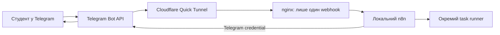

# Інфраструктура навчального пакета

Версія 0.2 · 8 листопада 2026 року.

Цей документ описує реалізовану структуру пакета. Цільовий комп'ютер —
HP Pavilion 14-ce0064ur із Windows 11 Home 25H2, приблизно 8 ГБ RAM,
Docker Desktop і WSL 2. На цьому комп'ютері вже успішно перевірено Docker Engine,
Compose і контейнер `hello-world`.

## 1. Мета системи

Пакет дає студенту простий локальний стенд для першого знайомства з AI-агентами.
Студент запускає одне вікно, пише власному Telegram-боту й отримує відповідь від
workflow у n8n. Початковий приклад повертає `Отримано: <текст>`; AI-модель можна
додати до workflow пізніше.

Система працює, поки запущені ноутбук, Docker Desktop і пакет. Для першої версії
не потрібні VPS, власний домен або відкриті порти домашнього роутера.

## 2. Мінімальна архітектура

Основний ланцюжок:

**Telegram → tunnel → local n8n → Telegram response.**

Між tunnel і n8n є захисний proxy:

Telegram надсилає POST-запит на публічний webhook. Cloudflare передає його у
локальну Docker-мережу. nginx перевіряє точний шлях і секретний заголовок, а n8n
виконує workflow. Відповідь бот надсилає через офіційний Telegram Bot API.

## 3. Компоненти й роль кожного компонента

| Компонент | Роль |
| --- | --- |
| Docker Desktop + WSL 2 | Запускає Linux-контейнери на Windows. |
| Docker Compose | Разом створює, перевіряє й зупиняє компоненти пакета. |
| n8n `3.1.0` | Зберігає workflow, приймає webhook і керує виконанням. |
| SQLite + Docker volume | Зберігають обліковий запис, workflow, credentials та історію між запусками. |
| n8n task runners `3.1.0` | Виконують Code node в окремому офіційному контейнері. |
| nginx `1.30.6-alpine` | Не пропускає інтернет до редактора й перевіряє Telegram webhook secret. |
| cloudflared `2026.10.7` | Створює тимчасову публічну HTTPS-адресу. |
| PowerShell + WinForms | Показує кнопки запуску, зупинки, перевірки та важливі адреси. |

Усі образи в [compose.yaml](compose.yaml) мають і версію, і SHA-256 digest. Пакет
не використовує рухомий тег `latest`.

## 4. Що працює локально

На ноутбуці працюють WinForms launcher і чотири контейнери: n8n, task runners,
nginx та cloudflared. Редактор n8n, SQLite, workflow, credentials і налаштування
студента залишаються локальними.

База зберігається у Docker volume `n8n-course-kit_n8n_data`. Локальні
налаштування launcher зберігаються в `%LOCALAPPDATA%\N8nCourseKit`. Історія
успішних та помилкових виконань автоматично очищається: максимум 100 записів і
не довше семи днів.

Telegram і Cloudflare є зовнішніми сервісами. Повністю офлайн пакет не працює.

## 5. Що бачить інтернет

Інтернет бачить випадкову адресу виду `https://<name>.trycloudflare.com`, але
nginx обслуговує лише:

`POST /webhook/telegram-course`

Запит повинен мати правильний заголовок
`X-Telegram-Bot-Api-Secret-Token`. Інші шляхи, редактор, REST API n8n, test
webhook і неправильний секрет відхиляються до виконання workflow. Розмір запиту
обмежений 1 МБ, частота — 5 запитів за секунду з коротким burst до 10.

Telegram і Cloudflare передають вміст повідомлень, тому навчального бота не слід
використовувати для конфіденційних даних.

## 6. Порти й адреси

| Призначення | Адреса | Доступ |
| --- | --- | --- |
| Редактор n8n | `http://127.0.0.1:5678` | Лише цей Windows-ПК |
| n8n у Docker | `http://n8n:5678` | Лише Docker-мережа пакета |
| Broker task runners | `http://n8n:5679` | Лише Docker-мережа пакета |
| nginx у Docker | `http://proxy:8080` | Лише cloudflared у Docker-мережі |
| Публічна база | `https://<name>.trycloudflare.com` | Інтернет; маршрути фільтрує nginx |
| Telegram webhook | `https://<name>.trycloudflare.com/webhook/telegram-course` | Telegram із правильним секретом |
| Telegram API | `https://api.telegram.org:443` | Вихідні HTTPS-запити |

Порт 5678 прив'язаний саме до `127.0.0.1`, тому його не видно сусіднім пристроям
у Wi-Fi. Публікувати порт 5678 на роутері не потрібно.

## 7. Змінні середовища

Студент їх вручну не вводить. Launcher створює значення на час запуску Compose.

| Змінна | Призначення | Секрет |
| --- | --- | --- |
| `COURSEKIT_N8N_PORT` | Локальний порт редактора, стандартно `5678` | Ні |
| `COURSEKIT_WEBHOOK_URL` | Поточна база Quick Tunnel для `N8N_WEBHOOK_URL` | Ні |
| `COURSEKIT_NGINX_CONFIG` | Шлях до згенерованого правила nginx | Містить webhook secret |
| `COURSEKIT_ENCRYPTION_KEY_FILE` | Шлях до тимчасового файла ключа n8n | Так |
| `COURSEKIT_RUNNER_TOKEN_FILE` | Шлях до внутрішнього токена task runners | Так |
| `COURSEKIT_IMPORT_DIR` | Тимчасова папка bootstrap-файлів | Може містити токен |

n8n отримує секрети з read-only файлів через `N8N_ENCRYPTION_KEY_FILE` і
`N8N_RUNNERS_AUTH_TOKEN_FILE`. Токен Telegram імпортується як credential n8n і
не записується у workflow.

## 8. Правила для секретів

1. Токен Telegram не надсилати в чат, issue, commit або скриншот.
2. Launcher зберігає токен, ключ шифрування, webhook secret і runner token поза
   репозиторієм у DPAPI-зашифрованому файлі поточного користувача Windows.
3. Відкриті runtime-файли існують лише під час роботи в папці з ACL для цього
   користувача. Під час штатної зупинки папка видаляється.
4. Секрети не передаються у параметрах команд. Внутрішній runner token
   монтується як файл, а Telegram token потрапляє лише в тимчасовий credential JSON.
5. `.gitignore` виключає локальні бази, `.env`, логи, runtime і backups.
6. Резервна копія містить персональні дані. Вона доступна лише поточному
   користувачу Windows, а DPAPI-секрети відновлюються лише тим самим користувачем.
7. Якщо токен став публічним, його треба відкликати через BotFather і зберегти новий.

## 9. Обраний tunnel і fallback

Основний варіант — **Cloudflare Quick Tunnel** через офіційний `cloudflared`.
Він не потребує домену або акаунта, працює через вихідне з'єднання й підходить
для уроку. Після нового запуску адреса може змінитися. Launcher розпізнає стару
адресу свого пакета, отримує нову й оновлює Telegram webhook. Чужий webhook він
не перезаписує.

Fallback — **ngrok**, але він поки не реалізований: потрібні акаунт, окремий
секрет і перевірка тарифних обмежень. Для довготривалої роботи кращим наступним
кроком буде іменований Cloudflare Tunnel із власним доменом.

## 10. Як запускати систему

Перший раз:

1. Запустити Docker Desktop і дочекатися `Engine running`.
2. Створити окремого навчального бота через `@BotFather` і написати йому `/start`.
3. Двічі натиснути [start.cmd](start.cmd).
4. Ввести токен у масковане поле, знайти або ввести Telegram user ID і натиснути
   **Зберегти налаштування**.
5. Натиснути **Запустити**. Коли відкриється n8n, один раз створити локального
   власника, повернутися у launcher і ще раз натиснути **Запустити**.

Звичайний запуск потребує лише Docker Desktop, [start.cmd](start.cmd) і кнопки
**Запустити**. Launcher перевіряє Docker та токен, запускає локальні сервіси,
не перезаписує змінений студентом workflow, створює tunnel і реєструє webhook.

Резервну копію можна створити подвійним кліком [backup.cmd](backup.cmd). Вона
потрапить у `Документи\N8nCourseKitBackups`. Для відновлення використовується
[restore.cmd](restore.cmd): він просить вибрати ZIP, показує попередження й
перед заміною робить страхову копію поточного стану.

## 11. Як зупиняти систему

У launcher натиснути **Зупинити**. Пакет:

1. перевіряє, що Telegram webhook належить саме йому;
2. видаляє тільки свій webhook без очищення pending updates;
3. зупиняє лише контейнери Compose-проєкту `n8n-course-kit`;
4. видаляє тимчасові відкриті секрети;
5. зберігає Docker volume, workflow, credentials і DPAPI-налаштування.

Docker Desktop та сторонні контейнери не вимикаються. Закриття вікна launcher
не зупиняє вже запущений стек; для коректної зупинки слід натиснути кнопку.

## 12. Як зрозуміти, що все працює

Ознаки готовності:

1. launcher показує зелений стан **готово** і публічну адресу;
2. кнопка **Відкрити n8n** відкриває локальний редактор;
3. кнопка **Перевірити** підтверджує готовність бази та Telegram webhook;
4. повідомлення `Привіт` від дозволеного користувача повертає
   `Отримано: Привіт`;
5. у n8n видно успішне виконання workflow;
6. публічні `/`, `/rest/settings` і `/webhook-test/...` недоступні;
7. після зупинки й запуску дані збережені, а новий URL tunnel зареєстровано.

Автоматизовані Linux-перевірки не замінюють фінальний Telegram E2E і перевірку
WinForms на цільовому Windows. Фактичні результати записуються у
[VALIDATION.md](VALIDATION.md).

## 13. Як цю логіку потім перенести на VPS

1. Підготувати Linux VPS із Docker Compose та постійною HTTPS-адресою.
2. Зробити локальну резервну копію й зупинити пакет, щоб один бот не мав двох
   конкурентних запусків.
3. Захищено перенести базу n8n і ключ шифрування. DPAPI-файл напряму на Linux
   не працює, тому потрібна окрема процедура захищеного експорту секретів.
4. Відновити volume, credentials і workflow на VPS.
5. Публічно відкрити лише webhook через nginx; редактор залишити за VPN,
   SSH-тунелем або іншою адміністративною межею.
6. Зареєструвати постійну адресу Telegram webhook і пройти повний E2E.
7. Додати автоматичний старт, моніторинг, резервування й план оновлень.

SQLite достатньо для одного навчального екземпляра. PostgreSQL і workers мають
сенс пізніше, коли з'являться паралельне навантаження та вимоги до доступності.
